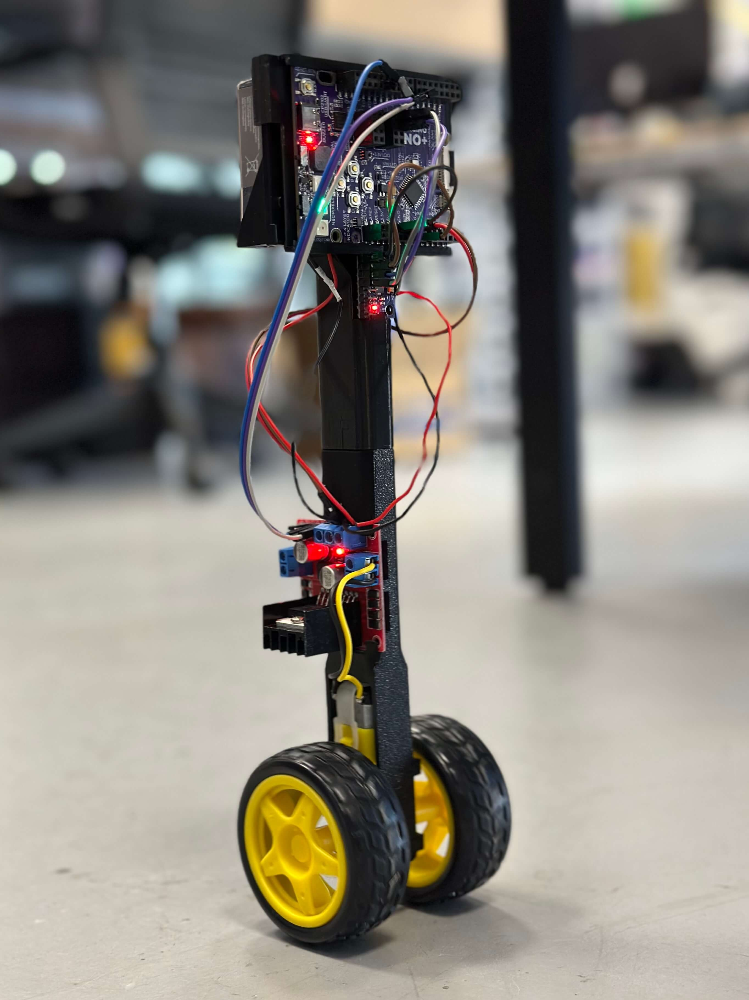
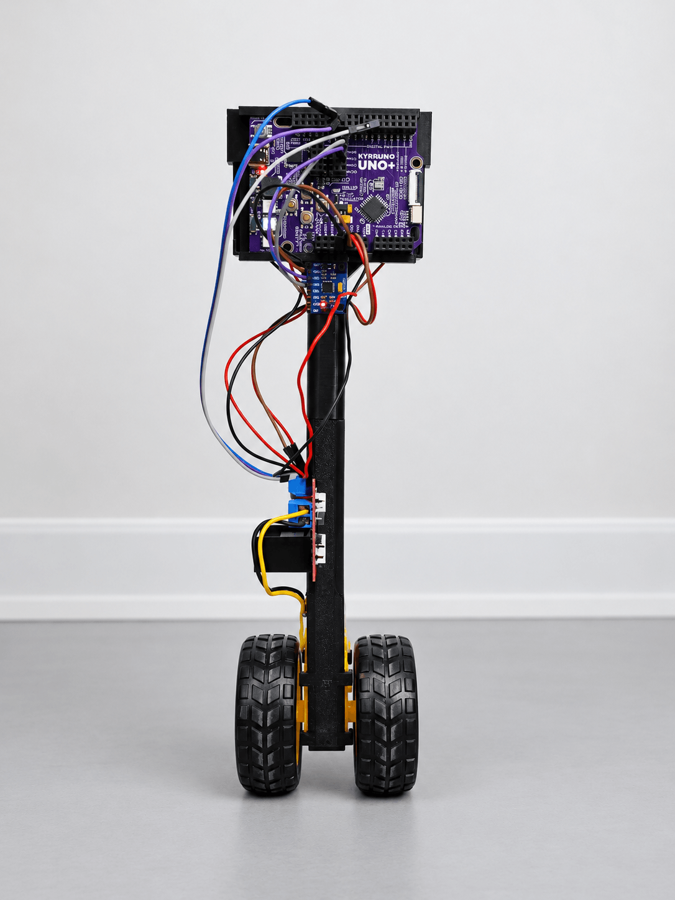

# BalanceBot — Kypruino Self-Balancing Robot

A two-wheeled robot that stands up on its own. 200 times a second an MPU6050 measures how far it is leaning, and the Kypruino drives a single TT gear motor (which turns both wheels) through an L298N to roll the wheels back underneath it. On top of that it holds its spot by leaning gently against its own drift, and fine-tunes its balance angle while it runs. The onboard NeoPixels show which way it is leaning and the buzzer reports what it is doing.

A black box in EEPROM keeps the last ~2 s of each of the last 3 runs (pitch, tilt, rate, motor PWM, 5 V supply) and why each run ended, so a run without a USB cable can still be checked afterwards.

  
  

More photos in [images/](images/), including the [wiring diagram](images/balance-bot-wiring.png) and a [render of the frame](images/balance-bot-render.png).

## Build

| | |
|---|---|
| **Code** | [`code/BalanceBot/BalanceBot.ino`](code/BalanceBot/BalanceBot.ino) |
| **3D parts** | [`stl/balance-bot.stl`](stl/balance-bot.stl) |
| **Hardware** | Kypruino, MPU6050 accelerometer/gyro, L298N motor driver, TT gear motor with two wheels, 2× 9 V batteries + clips, jumper wires, USB-C cable |
| **Wiring** | MPU6050 SDA → A4 · SCL → A5 · VCC → 5V · GND → GND L298N ENA → D5 (remove the ENA jumper) · IN1 → D10 · IN2 → D11 · OUT1/OUT2 → motor · 5V → Kypruino 5V · GND → Kypruino GND Batteries (in parallel) → L298N 12V / GND. Keep the L298N 5V-enable jumper on: its regulator powers the Kypruino |
| **Onboard** | NeoPixels → D8 · Buzzer → D9 (both switches ON) · Button B (D6) = start / stop |
| **Libraries** | MPU6050_light, Adafruit NeoPixel (Wire and EEPROM built in) |
| **Config** | Balance: `Kp`, `Kd`, `KV`, `KX`, `RETURN_LEAN` · Motor: `DEADBAND` · Safety: `FALL_DEG`, `ARM_DEG`, `ARM_MS` · Lights: swap `PIX_BACK` / `PIX_FWD` if the side lights look reversed |
| **Print** | One-piece frame, about 27 × 81 × 269 mm: Kypruino cradle on top, mast with mounts for the MPU6050 and L298N, TT motor holder at the bottom |
| **Guide** | [Read the full build](https://robo.com.cy/blogs/blog/kypruino-self-balancing-robot) |

### Getting it to balance

1. Mount the MPU6050 firmly, with its Y axis pointing up and its X axis along the wheel axle. Upright then reads about 90°.
2. Power it on lying flat and still: it calibrates the gyroscope (blue lights, then 2 rising beeps).
3. Hold it upright and still: after 0.4 s it starts balancing. Then let go.
4. If the wheels drive away from the lean instead of underneath it, swap the two motor wires or send `f` in the Serial Monitor (saved in EEPROM).

The balance angle starts at 92° and is adjusted while it runs; long runs save part of the correction in EEPROM. Send `Z` and a number (e.g. `Z91.3`) to set it yourself.

### Lights and sounds

| NeoPixels | Meaning | Sound | Meaning |
|---|---|---|---|
| Blue | Calibrating, keep it still | 2 rising beeps | Ready |
| Green blink | Ready; an amber side = tip it that way to start | 1 low beep | It moved while calibrating |
| All green | Upright, about to start | Falling tones | It fell |
| Middle green / red side | Balancing on target / leaning that way | 3 high beeps | Sensor dropped out |
| Red blink | Fell | 3 low beeps | Last run was cut short by a reset (power) |
| Purple ×3 | Last run was cut short by a reset (power) | | |
| Yellow | Sensor dropped out, recovering | | |

### Serial Monitor (115200 baud, newline)

| Command | Does |
|---|---|
| `s` | Status, including the current pitch |
| `v` / `V` | Text telemetry at 20 Hz / binary data stream at 200 Hz |
| `D` / `E` | Print / erase the black box |
| `x` / `b` | Stop / start · `a0` / `a1` automatic start off / on |
| `p#` `d#` `u#` `h#` | Gains `Kp`, `Kd`, `KV`, `KX` |
| `r#` `n#` `Z#` | Return lean cap, deadband, balance angle |
| `f` | Flip the motor direction |
| `C` | Re-calibrate the gyro (lying still) |
| `M` / `W` | Motor test / deadband sweep (both with the wheels in the air) |

Values sent this way are lost on restart: copy the ones that work into the code.

## Notes

The gains are tuned on our robot; a different build may need small changes, so try them live over serial first. `Kd` damps the swing of the heavy top: too high and the motor buzzes back and forth, too low and it overshoots. `KV` is the key term, it makes the robot brake a drift on purpose instead of following it until the motor runs out of speed. Measure your motor's `DEADBAND` with `W` before tuning anything else.

Use fresh batteries. If the supply collapses under motor load the Kypruino resets mid-run; at the next boot it blinks purple three times and plays 3 low beeps, and the black box marks the run as a brownout with the lowest 5 V reading it saw (send `D`).
